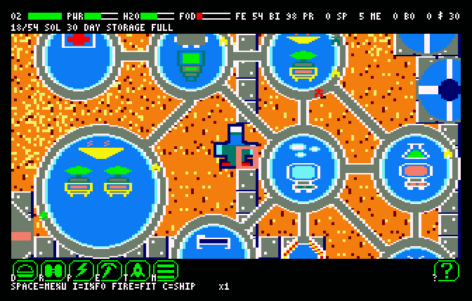

# Habitat

A colony-survival game for the **Amstrad CPC 6128**: 128 KB, Mode 0, disc.

A ship drops six colonists and a hold of materials on an empty world, and you place
what the colony needs. You never give an order. The colonists walk out, take the work
your buildings offer, eat, sleep and breathe on their own, and either keep the oxygen
running or do not.

The systems are modelled on *Planetbase* (Madruga Works, 2015), cut down until they
fit in a Z80 and 128 KB.



**Manuals:** [English](docs/manual-en.md) · [Ελληνικά](docs/manual-el.md)

---

## What is in the game

- **A world built for each game**: 128 × 128 tiles from a 16-bit seed, on four
  planets (desert, ice, storm, barren moon), chosen from a menu drawn over a piece of
  a real world. There is also a **tutorial**: fourteen guided steps on a barren moon,
  then a normal game.
- **Domes and corridors:**
  - three dome sizes and ten rooms, fitted slot by slot with the machines the room
    allows;
  - corridors laid automatically to the domes in reach;
  - airlocks as the only doors, and paths on the ground to the structures outside.
- **Autonomous colonists**, up to 160, and 16 bots:
  - five specialties — worker, engineer, biologist, medic, guard;
  - six needs — oxygen, water, food, sleep, health, morale;
  - suits that run out of air outside.
- **An economy of two flows and fourteen goods.** The flows are power and oxygen. The
  goods are water, food, ore, metal, bioplastic, processors, spares, medicine, guns,
  bots, starch, vegetables, medicinal plants and meat. It runs through mines,
  factories, labs, greenhouses and canteens.
- **Ships:**
  - colonist ships that you call, with the specialties' shares chosen in steps of 10%;
  - visitors who pay coins, coming more often with the colony's prestige;
  - merchants, who trade once a visit;
  - intruders, whom the guards fight.
- **Hazards:** night, malfunctions, sandstorms, solar flares, meteor showers and
  intruders.
- **Demolition**, an info key, four speeds, and **save and load** in three slots on the
  game's own disc.
- **Sound:** effects on the AY, and a tune during world generation.

The game loads from its own disc. `RUN"HABITAT` shows the menu after a few seconds,
and the chosen world is built in about five.

| | |
|---|---|
| World | 128 × 128 tiles, generated from its seed. The same seed always builds the same world. |
| Colony | up to 160 colonists and 16 bots, all autonomous |
| View | 20 × 10 tiles at a time, hardware-scrolled, with a two-mode raster split for the HUD |
| Memory | all eight 16 KB banks: world, routing tables, sprites, simulation, two screen pages |

## Status

It is a complete game. The ten delivery milestones of
[`DESIGN.md` §14](DESIGN.md#14-delivery-plan) are built, and what remains is tuning.

- **160 colonists since milestones 173–174.** The game holds them
  ([`DESIGN.md` §6.1](DESIGN.md#the-ids-at-milestone-173)), and the scripted player
  ends 160 sols with 113 colonists a world on average, two worlds of eight at 157–159
  ([§10.1](DESIGN.md#a-hundred-and-sixty-at-milestone-174)). What holds the others
  back — power, Metal, room — is in [§15](DESIGN.md#15-open-risks).
- **Still owed: a check on a real CPC 6128.** The raster splits, the disc's timing and
  the mid-frame CRTC writes have been tested only on the emulator
  ([`DESIGN.md` §15](DESIGN.md#15-open-risks)).

## Playing

Build the disc (below), then on a 6128 or a 6128 emulator:

```
RUN"HABITAT
```

The [player's manual](docs/manual-en.md) covers the controls, the buildings, the
colonists, the ships and the hazards. It also has a step-by-step first colony. The
game saves onto its own disc, so use a copy that is not write-protected.

## Building

| Tool | Path | Role |
|---|---|---|
| `rasm` | `~/rasm/rasm.exe` | assembler |
| `iDSK` | `~/idsk/iDSK` | disc image tool |
| `cpcemu` | `~/cpcemu/cpc.py` | headless CPC 6128 emulator, renders to PNG |
| Python 3 | with Pillow | the tools and the tests |

From a fresh clone:

```bash
./tools/build.sh --gen          # tables and bank images from the assets
python3 tools/mkgentables.py    # the world generator's tables
python3 tools/mkdsk.py          # assembles everything, writes build/habitat.dsk
```

`./tools/build.sh` without `--gen` also runs the test suite. Everything it makes goes
to `build/`, which is not in the repository.

## Testing

The emulator is headless and scriptable, so the game is tested as it runs:

- **89 tests in `tests/`.** They cover the blit kernels and every drawing, byte for
  byte against reference renderers. They check the simulation against Python
  reference models (`tools/entity.py`, `tools/econ.py`, `tools/graph.py`), the UI
  through its keys, and the disc loader and the save from a cold boot. They hold cost
  ceilings in µs, with negative controls that must fail.
- **`tools/play.py`** is a scripted player that plays whole games of 120 sols on the
  real binary. It is how the balance is measured.
- **`tools/tickplay.py`** runs the same player with the wheel's ticks for its clock, so
  that a change that should not alter the game can be shown to give the same games,
  event for event.

## Repository

```
DESIGN.md        the design document, kept up to date milestone by milestone
README.md        this file
docs/            the player's manuals (English, Greek) and their screenshots
src/             the game, in Z80 assembly (rasm)
tools/           build tools, reference models, the scripted player
tests/           the test suite and its golden images
assets/          Mode 0 graphics, generated in the CPCArt repo; do not edit by hand
sync-assets.sh   pulls the graphics from CPCArt
```

The graphics are made in the [`CPCArt`](../CPCArt) repo and copied in with
`./sync-assets.sh --regen`. `assets/SPRITES.md` documents every sprite.

## Reading the code

Start with [`DESIGN.md`](DESIGN.md). Three parts explain most of the rest:

1. **[§2.2 The frame budget](DESIGN.md#22-the-frame-budget)**: drawing one large dome
   costs almost six frames, and every other decision follows from that.
2. **[§4 The memory map](DESIGN.md#4-memory-map--all-128-kb)**: all eight banks are
   spoken for, with a few hundred bytes to spare.
3. **[§7 The batch scheduler](DESIGN.md#7-the-batch-scheduler)**: agents, production,
   routing and events are sliced over a 16-frame wheel with a fixed budget per frame.
   The simulation is allowed to think more slowly as the colony grows; the frame rate
   is not allowed to drop.
