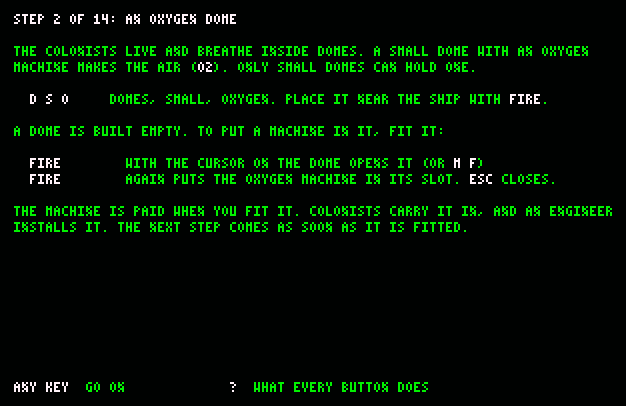

# Habitat — Εγχειρίδιο του παίκτη

*Μια αποικία σε έναν νεκρό κόσμο, για τον Amstrad CPC 6128.*

[English](manual-en.md) · [README](../README.md)


---

## Περιεχόμενα

1. [Τι είναι το Habitat](#1-τι-είναι-το-habitat)
2. [Τι χρειάζεσαι](#2-τι-χρειάζεσαι)
3. [Νέο παιχνίδι](#3-νέο-παιχνίδι)
4. [Η οθόνη](#4-η-οθόνη)
5. [Τα πλήκτρα](#5-τα-πλήκτρα)
6. [Η πρώτη αποικία, βήμα βήμα](#6-η-πρώτη-αποικία-βήμα-βήμα)
7. [Χτίσιμο](#7-χτίσιμο)
8. [Θόλοι, δωμάτια και μηχανές](#8-θόλοι-δωμάτια-και-μηχανές)
9. [Έξω από τους θόλους](#9-έξω-από-τους-θόλους)
10. [Άποικοι και ρομπότ](#10-άποικοι-και-ρομπότ)
11. [Ενέργεια, αέρας, νερό, τροφή, αποθήκη](#11-ενέργεια-αέρας-νερό-τροφή-αποθήκη)
12. [Πλοία: άποικοι, επισκέπτες, έμποροι, εισβολείς](#12-πλοία-άποικοι-επισκέπτες-έμποροι-εισβολείς)
13. [Κίνδυνοι](#13-κίνδυνοι)
14. [Η γραμμή των ειδοποιήσεων](#14-η-γραμμή-των-ειδοποιήσεων)
15. [Πληροφορίες, κατεδάφιση, ταχύτητα, σώσιμο](#15-πληροφορίες-κατεδάφιση-ταχύτητα-σώσιμο)
16. [Στόχοι, και η ήττα](#16-στόχοι-και-η-ήττα)
17. [Συμβουλές](#17-συμβουλές)
18. [Όρια που καλό είναι να ξέρεις](#18-όρια-που-καλό-είναι-να-ξέρεις)

Τα κείμενα της οθόνης είναι στα αγγλικά. Εδώ γράφονται όπως φαίνονται, με κεφαλαία,
π.χ. `NO POWER`.

---

## 1. Τι είναι το Habitat

Ένα πλοίο αφήνει έξι αποίκους και ένα αμπάρι γεμάτο υλικά σε έναν άδειο κόσμο, και
εσύ είσαι ο αρχιτέκτονας της βάσης. Αποφασίζεις **πού** μπαίνει κάθε κτίριο, ποτέ
**ποιος** κάνει τι. Οι άποικοι βγαίνουν, πιάνουν όποια δουλειά προσφέρουν τα κτίριά
σου και φροντίζουν μόνοι τους τις ανάγκες τους. Αν βάλεις γεννήτρια οξυγόνου χωρίς
ρεύμα, κανείς δεν σε σταματά: απλώς πνίγονται.

Ο κύκλος είναι: **χτίζεις → παράγεις → βγάζεις τη νύχτα → καλείς το επόμενο πλοίο →
χτίζεις κι άλλο.** Κάθε κτίριο θέλει κάτι που φτιάχνει ένα άλλο, και η αποικία είναι
πάντα ένας κρίκος μακριά από τον μπελά. Το Habitat βασίζεται στο *Planetbase*
(Madruga Works, 2015), κομμένο ώστε να χωρά σε έναν Z80 και 128 KB.

Οθόνη νίκης δεν υπάρχει. Μια αποικία ή συνεχίζει ή όχι.

## 2. Τι χρειάζεσαι

- Έναν **Amstrad CPC 6128** (το παιχνίδι θέλει και τα 128 KB) με το δισκέτο του, ή
  έναν emulator ρυθμισμένο ως 6128.
- Τη δισκέτα του παιχνιδιού, `habitat.dsk` (πώς φτιάχνεται, στο [README](../README.md)).
- **Το παιχνίδι σώζει πάνω στη δική του δισκέτα.** Χρησιμοποίησε αντίγραφο, και μην
  την έχεις κλειδωμένη για εγγραφή, αλλιώς το σώσιμο βγάζει `DISC ERROR`.

## 3. Νέο παιχνίδι

Βάλε τη δισκέτα και γράψε:

```
RUN"HABITAT
```

Μετά από λίγα δευτερόλεπτα εμφανίζεται το μενού, πάνω σε ένα κομμάτι κόσμου, άλλο κάθε
φορά.


**CHOOSE A WORLD**: κινείσαι με τα βελάκια ή το joystick και διαλέγεις με `FIRE` ή
`ENTER`. Η γραμμή κάτω από τη λίστα περιγράφει τον κόσμο:

| Γραμμή | Κόσμος |
|---|---|
| `RANDOM` | ένας από τους τέσσερις |
| `DESERT` | έρημος: νερό, στεριά, λίγο μετάλλευμα |
| `ICE` | πάγος: πολύ νερό, λίγο μετάλλευμα |
| `STORM` | καταιγίδα: βουνά, μετάλλευμα, ξηρασία |
| `BARREN MOON` | άγονο φεγγάρι: σκόνη, μετάλλευμα, ελάχιστο νερό |
| `TUTORIAL` | μάθε να χτίζεις αποικία (πάντα το ίδιο άγονο φεγγάρι) |

Κάθε επιλογή εκτός από το `TUTORIAL` φτιάχνει έναν **καινούργιο κόσμο** αυτού του
είδους, από τυχαίο seed. Το παιχνίδι φορτώνει και μετά χτίζει τον κόσμο σε περίπου
πέντε δευτερόλεπτα, με μουσική.


Το παιχνίδι ξεκινά χωρίς τίποτα χτισμένο: οι έξι άποικοι στέκονται έξω, δίπλα στο
πλοίο, στη μέση του χάρτη.


Το αμπάρι του πλοίου φέρνει **60 Νερό, 100 Τροφή, 60 Μετάλλευμα, 189 Μέταλλο, 137
Βιοπλαστικό και 12 Ανταλλακτικά**. Οι έξι είναι τέσσερις εργάτες, ένας μηχανικός
και ένας βιολόγος. Οι στολές τους έχουν αέρα για περίπου δέκα λεπτά, οπότε οι πρώτοι
θόλοι βιάζονται.

## 4. Η οθόνη

**Οι πάνω σειρές** (το HUD):

```
O2 ██████ PWR ██████ H2O ████·· FOD ██····  FE189 BI137 PR  0 SP 12 ME  0 BO  0 $  0
6/6 SOL  0 DAY ALL SYSTEMS OK
```

- **Τέσσερις μπάρες:** οξυγόνο (`O2`), ενέργεια (`PWR`), νερό (`H2O`) και τροφή
  (`FOD`). Μια μπάρα γίνεται **κόκκινη κάτω από το ένα τρίτο**.
- **Έξι αποθέματα:**
  - `FE` Μέταλλο·
  - `BI` Βιοπλαστικό·
  - `PR` Επεξεργαστές·
  - `SP` Ανταλλακτικά·
  - `ME` Φάρμακα·
  - `BO` ρομπότ που περιμένουν να ξυπνήσουν.
- **`$` νομίσματα**, που πληρώνουν οι επισκέπτες.
- **Ζωντανοί άποικοι / όριο** (`6/6`, `140/160`), το **sol** (ο αριθμός της μέρας),
  `DAY` ή `NGT` (νύχτα).
- **Η γραμμή των ειδοποιήσεων**: το πιο επείγον που συμβαίνει
  ([ενότητα 14](#14-η-γραμμή-των-ειδοποιήσεων)).

**Το πεδίο του παιχνιδιού** δείχνει 20 × 10 tiles του κόσμου. Η κάμερα ακολουθεί τον
κέρσορα όταν φτάσει στις άκρες.

**Οι κάτω σειρές:**
- **Η μπάρα με τα κουμπιά** έχει έξι ομάδες και τη βοήθεια: `D` θόλοι, `R` διάδρομος,
  `P` ενέργεια, `E` πόροι, `T` μεταφορές, `M` διαχείριση, `?` βοήθεια. Μέσα σε μια
  ομάδα η μπάρα δείχνει τα δικά της κουμπιά.
- **Η γραμμή των πλήκτρων** λέει τι κάνουν τα πλήκτρα εκείνη τη στιγμή, π.χ.
  `SPACE=MENU I=INFO FIRE=FIT C=SHIP`.
- **Η ταχύτητα**: `PAUSE`, `x1`, `x2` ή `x4`.
- **Όσο χτίζεις**, οι δύο σειρές δείχνουν την επιλογή, την τιμή της και αν μπορεί να
  μπει: `READY  FIRE TO BUILD`, ή τον λόγο που δεν μπορεί.

## 5. Τα πλήκτρα

Όλα γίνονται με πλήκτρο. Οι τέσσερις κατευθύνσεις και τα δύο fire δουλεύουν και με
joystick.

| Πλήκτρο | Τι κάνει |
|---|---|
| Βελάκια / joystick | Κινούν τον κέρσορα, ένα πλακίδιο σε κάθε πάτημα. Κρατημένα, τον κινούν ξανά κάθε πέμπτο του δευτερολέπτου. Σε μενού, αριστερά/δεξιά διαλέγει αντικείμενο και πάνω/κάτω δωμάτιο. |
| `FIRE` / `COPY` | Επιλογή, επιβεβαίωση, τοποθέτηση. Πάνω σε θόλο, χωρίς άλλη επιλογή: ανοίγει τις μηχανές του (`FIT`). |
| `ESC` / fire 2 | Ακύρωση, πίσω. |
| `SPACE` | Πας στην μπάρα με τα κουμπιά. Αριστερά/δεξιά διαλέγει ομάδα, `FIRE` ή `SPACE` την ανοίγει. Ανοίγει στην ομάδα από την οποία έχτισες τελευταία, οπότε `SPACE` `SPACE` σε ξαναφέρνει εκεί που ήσουν. Όταν τοποθετείς κτίριο ή διάδρομο, το `SPACE` τοποθετεί, όπως το `FIRE`. |
| Το γράμμα ενός κουμπιού | Πατά αυτό το κουμπί, όσο είναι στην μπάρα. Από την κύρια οθόνη: `D` `R` `P` `E` `T` `M`. |
| `?` (το πλήκτρο `/`) | Η οθόνη βοήθειας: κάθε κουμπί με μία γραμμή για το τι κάνει. Με οποιοδήποτε πλήκτρο γυρίζεις. |
| `1` `2` `3` `4` | Ταχύτητα: παύση, κανονική, ×2, ×4. Και σε παύση μπορείς να χτίζεις. |
| `I` | Πληροφορίες: τι υπάρχει κάτω από τον κέρσορα. |
| `H` | Η κάμερα στη μέση του χάρτη, εκεί που είναι το πλοίο. |
| `S` / `L` | Σώσιμο / φόρτωμα, από την κύρια οθόνη ([ενότητα 15](#15-πληροφορίες-κατεδάφιση-ταχύτητα-σώσιμο)). |
| `C` | Κάλεσμα πλοίου με αποίκους ([ενότητα 12](#12-πλοία-άποικοι-επισκέπτες-έμποροι-εισβολείς)). |


**Τα κουμπιά κάθε ομάδας:**

| Ομάδα | Κουμπιά |
|---|---|
| `D` DOMES (θόλοι) | `S` μικρός, `M` μεσαίος, `L` μεγάλος· μετά το δωμάτιο: `O` οξυγόνο, `C` καντίνα, `Q` καταλύματα, `G` θερμοκήπιο, `F` εργοστάσιο, `B` εργαστήριο, `E` ιατρείο, `N` αίθουσα ελέγχου, `T` αποθήκη, `U` σαλόνι |
| `R` CORRIDOR (διάδρομος) | ενώνεις μόνος σου δύο θόλους |
| `P` POWER (ενέργεια) | `S` ηλιακό πάνελ, `T` ανεμογεννήτρια, `C` συσσωρευτής |
| `E` RESOURCES (πόροι) | `X` αντλία νερού, `M` ορυχείο |
| `T` TRANSPORT (μεταφορές) | `A` αεροθάλαμος, `P` πίστα προσγείωσης, `C` πλοίο, `M` εμπόριο |
| `M` MANAGE (διαχείριση) | `I` πληροφορίες, `F` μηχανές, `S` σώσιμο, `L` φόρτωμα, `H` κέντρο, `D` κατεδάφιση |

Ένα κουμπί ζωγραφισμένο κόκκινο δεν μπορεί να πατηθεί εκείνη τη στιγμή. Για παράδειγμα,
το `TRADE` είναι κόκκινο όσο δεν υπάρχει έμπορος στην πίστα.

## 6. Η πρώτη αποικία, βήμα βήμα

Αυτή είναι η σειρά που διδάσκει το tutorial, και ένα καλό άνοιγμα σε κάθε κόσμο. Τα
γράμματα είναι τα πλήκτρα, από την κύρια οθόνη.

| # | Πλήκτρα | Τι χτίζεις |
|---|---|---|
| 1 | `P` `S` | ένα **ηλιακό πάνελ**, και `FIRE` για να μπει |
| 2 | `D` `S` `O` | έναν μικρό **θόλο οξυγόνου**· μετά `FIRE` πάνω στον θόλο, και ξανά `FIRE` για να μπει η μηχανή `OXYGEN` |
| 3 | `T` `A` | έναν **αεροθάλαμο** δίπλα στον θόλο: η μόνη είσοδος και έξοδος |
| 4 | `E` `X` | μια **αντλία νερού** στην όχθη |
| 5 | `D` `S` `C` | μια **καντίνα**, με τη μηχανή `MEALS` |
| 6 | `P` `S` | **άλλο ένα ηλιακό πάνελ** |
| 7 | `P` `C` | έναν **συσσωρευτή**, για να κρατά ρεύμα για τη νύχτα |
| 8 | `E` `M` | ένα **ορυχείο**, πάνω σε φλέβα μεταλλεύματος αν γίνεται |
| 9 | `D` `S` `F` | ένα **εργοστάσιο**, με τη μηχανή `METAL` |
| 10 | `D` `M` `G` | ένα μεσαίο **θερμοκήπιο**, με φυτά |
| 11 | `D` `S` `B` | ένα **εργαστήριο**, με τη μηχανή `MEAT` |
| 12 | `D` `S` `N` | μια **αίθουσα ελέγχου** |
| 13 | `T` `P` | μια **πίστα προσγείωσης** |
| 14 | `C`, `FIRE` | **κάλεσε πλοίο με αποίκους** |



**Το tutorial εξηγεί κάθε βήμα σε δική του σελίδα** (στα αγγλικά, όπως όλο το
παιχνίδι).
- Πριν από οτιδήποτε άλλο, μια σελίδα για την οθόνη: οι μπάρες, τα αποθέματα, ο
  κέρσορας και τα κουμπιά. Μετά η σελίδα του βήματος 1.
- Όταν τελειώνει ένα βήμα, το παιχνίδι σταματά και δείχνει τη σελίδα του επόμενου: τι
  χτίζεις, γιατί το χρειάζεται η αποικία, ποια πλήκτρα πατάς και τι να προσέχεις.
  Οποιοδήποτε πλήκτρο σε γυρίζει στην αποικία.
- Η γραμμή του βήματος μένει κάτω από τα κουμπιά, και το `?` ξαναδείχνει τη σελίδα του.
  Ένα δεύτερο `?` πάνω στη σελίδα δείχνει τι κάνει κάθε κουμπί.
- Οι σελίδες διαβάζονται από τη δισκέτα (`TUTOR.TXT`), γι' αυτό άφησέ τη στον οδηγό.
  Χωρίς αυτήν, η σελίδα λέει πού βρίσκεται.

Το βήμα ολοκληρώνεται μόλις μπει το κτίριο. Κίνδυνοι δεν υπάρχουν ως τη στιγμή που θα
καλέσεις το πλοίο. Μετά μια τελευταία σελίδα λέει `THE COLONY IS YOURS`, και είναι πια
ένα κανονικό παιχνίδι, που σώζεται όπως κάθε άλλο.

## 7. Χτίσιμο


**Πώς χτίζεις κάτι:**
1. Το διαλέγεις από την μπάρα (π.χ. `D` `S` `O`).
2. Ένα **φάντασμα** του κτιρίου ακολουθεί τον κέρσορα. Είναι πράσινο εκεί που χωρά και
   κόκκινο εκεί που δεν χωρά, με τον λόγο στο πάνελ.
3. Το `FIRE` ή το `SPACE` το τοποθετεί, και το `ESC` γυρίζει πίσω.

**Τι κοστίζει:**
- Το πάνελ δείχνει την τιμή σε Μέταλλο (`FE`) και Βιοπλαστικό (`BI`), και η τιμή ενός
  θόλου περιλαμβάνει τους διαδρόμους του. **Πληρώνεται τη στιγμή που το τοποθετείς.**
- Μετά οι άποικοι **κουβαλούν τα υλικά** στο εργοτάξιο, δέκα τη φορά.
- Όταν φτάσουν όλα, ένας **μηχανικός** (ή ένα ρομπότ κατασκευών) το χτίζει. Αν δεν
  μπορεί κανείς, η γραμμή των ειδοποιήσεων λέει `NO ENGINEER`.

**Οι κανόνες της τοποθέτησης.** Κάθε κτίριο ενώνεται με την αποικία τη στιγμή που
τοποθετείται, μέσα σε **12 tiles**. Αν δεν μπορεί να ενωθεί, το φάντασμα είναι κόκκινο
και το πάνελ λέει γιατί.
- **Ένας θόλος** παίρνει σκεπαστό διάδρομο προς κάθε θόλο που φτάνει, ως τέσσερις,
  και προς κάθε αεροθάλαμο που δεν έχει ακόμη διάδρομο. Ο πρώτος θόλος μπαίνει
  οπουδήποτε.
- **Ένας αεροθάλαμος** (AIRLOCK) ενώνεται με διάδρομο με τον πιο κοντινό θόλο. Οι
  αεροθάλαμοι είναι οι μόνες πόρτες της αποικίας.
- **Ό,τι βρίσκεται έξω** — πάνελ, ανεμογεννήτριες, συσσωρευτές, αντλίες, ορυχεία,
  η πίστα — ενώνεται με **μονοπάτι στο έδαφος** με τον πιο κοντινό αεροθάλαμο ή άλλη
  κατασκευή. Η πρώτη δεν χρειάζεται τίποτα. Οι άποικοι περπατούν αυτά τα μονοπάτια με
  τις στολές τους.
- Με το κουμπί `R` ενώνεις μόνος σου δύο θόλους. Διαλέγεις τον πρώτο, μετά τον δεύτερο
  (`PICK THE FIRST DOME`, `NO ROUTE FROM THERE`).
- **Οι μεσαίοι και οι μεγάλοι θόλοι δεν παίρνουν οξυγόνο.** Οι μηχανές οξυγόνου
  χωρούν μόνο σε μικρούς θόλους.
- **Η αντλία θέλει νερό σε απόσταση ως δύο tiles** (`NEEDS WATER NEARBY`).
- **Ένα ορυχείο μακριά από φλέβα σκάβει με τη μισή απόδοση.** Το πάνελ λέει
  `NO VEIN  HALF ORE`, αλλά μπορείς να το χτίσεις.

**Μηνύματα που θα δεις:**

| Μήνυμα | Γιατί |
|---|---|
| `BLOCKED` | το έδαφος δεν χτίζεται, ή κάτι είναι στη μέση |
| `NOT ENOUGH MATERIAL` | δεν φτάνει το Μέταλλο ή το Βιοπλαστικό |
| `TOO FAR` | τίποτα από όσα θα μπορούσε να ενωθεί δεν είναι μέσα σε 12 tiles |
| `PATH BLOCKED` | ένας διάδρομος ή ένα μονοπάτι δεν μπορεί να περάσει |
| `NO CORRIDOR FITS` | οι δύο θόλοι είναι σχεδόν διαγώνια· μετακίνησε τον έναν λίγο |
| `NEEDS WATER NEARBY` | η αντλία δεν είναι στο νερό |
| `NO VEIN  HALF ORE` | το ορυχείο επιτρέπεται, με μισή απόδοση |

## 8. Θόλοι, δωμάτια και μηχανές

Ένας θόλος έχει **μέγεθος** και **δωμάτιο**, που τα διαλέγεις όταν τον τοποθετείς. Το
δωμάτιο δεν αλλάζει μετά.

| Μέγεθος | Έκταση | Θέσεις για μηχανές |
|---|---|---|
| μικρός (`S`) | 4 × 4 tiles | 1 |
| μεσαίος (`M`) | 6 × 6 | 4 |
| μεγάλος (`L`) | 8 × 8 | 8 |

**Ένας θόλος χτίζεται άδειος.** Για να βάλεις μηχανές, τον **εξοπλίζεις**:


- Το `FIRE` πάνω σε έναν θόλο (ή `M` `F`) τον ανοίγει.
- Αριστερά/δεξιά διαλέγει θέση, και πάνω/κάτω τι μπαίνει. Πρώτη έρχεται η κύρια
  μηχανή του δωματίου.
- Το `FIRE` τη βάζει, και το `SPACE` βάζει την ίδια μηχανή σε κάθε θέση, όσο φτάνουν τα
  υλικά. Το `ESC` κλείνει.
- Το πλαίσιο της θέσης είναι πράσινο όταν η μηχανή πληρώνεται, κόκκινο όταν δεν
  πληρώνεται, και ροζ όταν είναι ήδη εκεί.
- **Κάθε μηχανή πληρώνεται όταν τη βάζεις.** Μετά τα υλικά της κουβαλιούνται στον
  θόλο, και ένας μηχανικός την εγκαθιστά. Ως τότε φαίνεται σταματημένη, με ένα
  σημάδι. Τα φυτά φυτρώνουν αμέσως.
- Όταν βγάζεις μια μηχανή, παίρνεις πίσω **τη μισή** τιμή της.
- Μπορείς να εξοπλίσεις έναν θόλο και όσο χτίζεται ακόμη.
- Τα Καταλύματα, η Αποθήκη και το Σαλόνι δεν έχουν μηχανές.

**Τα δωμάτια** (με τα ονόματα όπως φαίνονται στην οθόνη):

| Δωμάτιο | Μηχανές | Τι κάνει |
|---|---|---|
| **OXYGEN** οξυγόνο (μόνο μικρός) | `OXYGEN` | Αέρας για την αποικία, από Νερό και Ενέργεια. Ένας θόλος οξυγόνου κρατά ζωντανούς περίπου δέκα αποίκους. |
| **CANTEEN** καντίνα | `MEALS` | Γεύματα από **Άμυλο + Λαχανικά + Κρέας**, και τα τρία. Εδώ οι άποικοι τρώνε και πίνουν. |
| **QUARTERS** καταλύματα | — | Κρεβάτια: 2 / 6 / 12 ανάλογα με το μέγεθος. |
| **GREENHOUSE** θερμοκήπιο | `STARCH`, `VEGGIES`, `HERBS`, `TREE`, `MIXED` | Φυτά: άμυλο, λαχανικά, βότανα (για φάρμακα), δέντρα (για το ηθικό, και οι επισκέπτες πληρώνουν περισσότερα), ή `MIXED`, λίγο από όλα. |
| **FACTORY** εργοστάσιο | `METAL`, `PLASTIC`, `SPARES`, `ROBOTS`, `WEAPONS` | Μετάλλευμα → Μέταλλο. Άμυλο → Βιοπλαστικό. Μέταλλο + Βιοπλαστικό → Ανταλλακτικά. Μέταλλο + Επεξεργαστές + Βιοπλαστικό → ένα ρομπότ. Μέταλλο + Επεξεργαστές → Όπλα. |
| **LAB** εργαστήριο | `MEAT`, `CHIPS`, `DRUGS` | Νερό + Ενέργεια → Κρέας. Μέταλλο → Επεξεργαστές. Βότανα → Φάρμακα. |
| **MEDBAY** ιατρείο | `BEDS`, `CABINET` | Γιατρεύει τους άρρωστους, με Φάρμακα. |
| **CONTROL** αίθουσα ελέγχου | `CHIPS` | Ανεβάζει το όριο της αποικίας κατά 48 και σου επιτρέπει να καλείς πλοία. |
| **STORAGE** αποθήκη | — | Χώρος για 100 / 300 / 600 αγαθά ακόμη, ανάλογα με το μέγεθος. |
| **LOUNGE** σαλόνι | — | Κρατά ψηλά το ηθικό, και οι επισκέπτες πληρώνουν περισσότερα. |

**Οι περισσότερες μηχανές θέλουν κάποιον να τις δουλεύει.** Οι εργάτες δουλεύουν τις
μηχανές και οι βιολόγοι φροντίζουν τα φυτά. Όσο περισσότεροι στέκονται σε έναν θόλο,
τόσο περισσότερες μηχανές του γυρίζουν. Η μηχανή `OXYGEN` δουλεύει μόνη της.

**Η αποικία κρατά μόνη της κάποια αποθέματα:**
- οι μηχανές που τρώνε Μέταλλο (`SPARES`, `ROBOTS`, `WEAPONS`, `CHIPS`) σταματούν όσο
  το Μέταλλο είναι κάτω από 30·
- η `PLASTIC` σταματά όσο το Βιοπλαστικό είναι 100 ή περισσότερο·
- η `SPARES` σταματά στα 20 Ανταλλακτικά.

Το χτίσιμο, ο εξοπλισμός και το εμπόριο δεν περιορίζονται ποτέ από αυτά.

## 9. Έξω από τους θόλους

| Κατασκευή | Τι κάνει |
|---|---|
| **SOLAR PANEL** ηλιακό πάνελ | Ενέργεια τη μέρα. Τίποτα τη νύχτα ή στην αμμοθύελλα. |
| **WIND TURBINE** ανεμογεννήτρια | Ενέργεια από τον αέρα, μέρα και νύχτα. |
| **COLLECTOR** συσσωρευτής | Κρατά το περίσσευμα της μέρας για τη νύχτα. |
| **EXTRACTOR** αντλία | Νερό από το έδαφος, δίπλα σε νερό. |
| **MINE** ορυχείο | Μετάλλευμα. Σκάβουν 1–3 άτομα: περισσότεροι, περισσότερο μετάλλευμα. **Το πρώτο ορυχείο της αποικίας είναι δωρεάν.** Το μετάλλευμα μαζεύεται στο ορυχείο (ως 30, μετά σταματά) και κουβαλιέται στην αποθήκη ή στο πλοίο, δέκα τη φορά. |
| **AIRLOCK** αεροθάλαμος | Η είσοδος και η έξοδος. |
| **LANDING PAD** πίστα | Εδώ προσγειώνονται τα πλοία. Χρειάζεται για κάθε είδος πλοίου. |

**Έξω, οι άποικοι αναπνέουν από τη στολή τους.**
- Στην αρχή η στολή έχει αέρα για περίπου δέκα λεπτά. Μετά έχει για περίπου τρία λεπτά
  ανά έξοδο, και ξαναγεμίζει δωρεάν κάθε φορά που βγαίνουν.
- Όταν μείνει λιγότερο από ένα λεπτό, η γραμμή λέει `SUIT AIR LOW` και ο άποικος
  γυρίζει πίσω.
- **Όταν η στολή αδειάσει, ο άποικος πεθαίνει.**

Βάζε τους αεροθαλάμους κοντά στις κατασκευές όπου δουλεύει κόσμος.

## 10. Άποικοι και ρομπότ

**Πέντε ειδικότητες**, όπως φαίνονται στη γραμμή του πλοίου:
- `WRK` εργάτης: δουλεύει μηχανές, σκάβει, κουβαλά·
- `ENG` μηχανικός: χτίζει, εγκαθιστά μηχανές, επισκευάζει·
- `BIO` βιολόγος: φροντίζει τα θερμοκήπια·
- `MED` γιατρός: γιατρεύει·
- `GRD` φρουρός: πολεμά τους εισβολείς.

Υλικά κουβαλά ο καθένας. Κανείς δεν παίρνει εντολές: πιάνουν τις δουλειές που
αναρτούν τα κτίρια, πρώτα την πιο επείγουσα, από την πιο κοντινή.

**Έξι ανάγκες:**
- **Οξυγόνο.** Μέσα, από τον αέρα της αποικίας. Έξω, από τη στολή.
- **Νερό και τροφή**, σε καντίνα.
- **Ύπνος**, στα καταλύματα.
- **Υγεία**, σε ιατρείο με Φάρμακα.
- **Ηθικό.** Τα σαλόνια, τα δέντρα και οι επισκέπτες το ανεβάζουν, και οι θάνατοι το
  ρίχνουν σε όλους.

Όταν μια ανάγκη πέσει χαμηλά, ο άποικος αφήνει τη δουλειά του και πάει να την
καλύψει. Αν η καντίνα είναι στην άλλη άκρη της βάσης, θα δεις την παραγωγή να
σταματά για τον δρόμο.

**Τα ρομπότ** τα φτιάχνει η μηχανή `ROBOTS`. Κάθε ένα μπαίνει στο απόθεμα των ρομπότ
(`BO`) και ξυπνά σε ένα εργοστάσιο με μηχανή `ROBOTS`, ως δεκαέξι. Ένα ρομπότ γίνεται
κατασκευαστής, μεταφορέας ή εξορύκτης, ό,τι χρειάζεται η αποικία. Τα ρομπότ δεν
αναπνέουν, δεν τρώνε και δεν κοιμούνται. Μπορείς να τα αγοράσεις και από έμπορο.

Η αποικία χωρά ως **160 αποίκους** και **16 ρομπότ**. Το όριό της ξεκινά από 6 και
ανεβαίνει κατά 48 με κάθε αίθουσα ελέγχου: 54 με μία, 102 με δύο, 150 με τρεις, και
όλοι οι 160 με τέσσερις.

## 11. Ενέργεια, αέρας, νερό, τροφή, αποθήκη

- **Ένα sol** (μια μέρα) κρατά τέσσερα λεπτά στην κανονική ταχύτητα, και περίπου το
  40% του είναι νύχτα.
- **Ενέργεια.** Τα πάνελ δεν δίνουν τίποτα τη νύχτα. Ένας συσσωρευτής περνά την αποικία
  απέναντι, και οι ανεμογεννήτριες γυρίζουν και στο σκοτάδι.
  - Όταν η ενέργεια δεν φτάνει, η αποικία κόβει φορτία: δουλεύει μόνο η υποστήριξη
    ζωής, και η γραμμή λέει `LOW POWER`.
  - Χωρίς καθόλου ενέργεια λέει `NO POWER`: σταματούν οι μηχανές και μετά το
    οξυγόνο.
- **Αέρας.** Αν δεν φτάνουν οι μηχανές οξυγόνου, ή η ενέργεια ή το νερό τους, η γραμμή
  λέει `NO OXYGEN` και η υγεία πέφτει γρήγορα.
- **Τροφή.** Η μηχανή `MEALS` μιας καντίνας ταΐζει περίπου έξι αποίκους, και θέλει
  Άμυλο, Λαχανικά και Κρέας μαζί. Τα δύο πρώτα τα δίνει το θερμοκήπιο και το τρίτο
  το εργαστήριο.
- **Αποθήκη.**
  - Ώσπου να χτίσεις θόλο αποθήκης, αποθήκη σου είναι το αμπάρι του πλοίου: 500 για
    όλα εκτός από το Νερό.
  - Κάθε θόλος αποθήκης προσθέτει 100, 300 ή 600 ανάλογα με το μέγεθος.
  - Όταν γεμίσει, η γραμμή λέει `STORAGE FULL`. Σταματούν τα θερμοκήπια, τα ορυχεία
    και η μηχανή του κρέατος, εκτός από όποιο από το Άμυλο, τα Λαχανικά και το Κρέας
    λείπει περισσότερο.

## 12. Πλοία: άποικοι, επισκέπτες, έμποροι, εισβολείς

Όλα τα πλοία προσγειώνονται στην **πίστα**, ένα τη φορά.

**Τα πλοία με αποίκους έρχονται όταν τα καλέσεις.**
- Θέλουν **αίθουσα ελέγχου** και **πίστα προσγείωσης**.
- Το `C` (ή το κουμπί `SHIP`) ανοίγει τη γραμμή του πλοίου:

  

- Αριστερά/δεξιά διαλέγει ειδικότητα, και πάνω/κάτω αλλάζει το μερίδιό της κατά 10%.
  Τα μερίδια βγάζουν πάντα 100.
- Το `FIRE` καλεί το πλοίο. Έρχεται λίγα δευτερόλεπτα μετά με **τέσσερις αποίκους**,
  ο καθένας από την ειδικότητα που λείπει περισσότερο από την αποικία σε σχέση με τα
  μερίδια.
- Τα μηνύματα: `NEED A CONTROL ROOM`, `NEED A LANDING PAD`, `A SHIP IS ALREADY DUE`,
  `COLONIST SHIP CALLED`.

**Οι επισκέπτες έρχονται μόνοι τους**, και πιο συχνά όσο μεγαλώνει το **κύρος** της
αποικίας.
- Κατεβαίνουν από δύο ως πέντε και πάνε σε καντίνα να φάνε και να πιουν. Ο καθένας
  πληρώνει **5 νομίσματα**, και 3 ακόμη αν έχεις σαλόνι ή δέντρα. Μετά περνούν από
  σαλόνι, αν υπάρχει, και γυρίζουν στο πλοίο τους.
- Χωρίς καντίνα, τροφή ή νερό φεύγουν νηστικοί, και η καλή διάθεση προς την αποικία
  πέφτει.
- **Το κύρος** ανεβαίνει με τα ορόσημα της αποικίας, με τους ζωντανούς αποίκους, με τα
  sol χωρίς θάνατο, με τα σαλόνια και τα δέντρα, και με την καλή διάθεση.

**Ένας έμπορος έρχεται περίπου κάθε 2,7 sol** και μένει μισό sol. Η γραμμή λέει
`MERCHANT LANDED`, και το `T` `M` (το κουμπί `TRADE`) ανοίγει τη γραμμή του
εμπορίου:

```
+40% TAKE  210 GIVE  250 FIRE=DEAL
 <METAL  > SHIP 20 TAKE 10 HAVE  75 @ 15
```

- Αριστερά/δεξιά περνάς τα αγαθά, πρώτα του εμπόρου.
- Το **πάνω** παίρνει μία παρτίδα ακόμη, και το **κάτω** δίνει μία ακόμη.
- Η πάνω γραμμή ζυγίζει όσα παίρνεις, με τις τιμές του εμπόρου, απέναντι σε όσα
  δίνεις, με την αξία τους. Το `FIRE` κλείνει τη συμφωνία όταν δίνεις τουλάχιστον όσα
  παίρνεις.
- **Μία συμφωνία ανά επίσκεψη.** Άποικοι και ρομπότ μεταφοράς κουβαλούν τα αγαθά από
  και προς την πίστα, και ο έμπορος φεύγει όταν τελειώσουν.
- Μπορείς να ανταλλάξεις και νομίσματα.

**Εισβολείς.** Από τη στιγμή που η αποικία έχει 20 αποίκους, περίπου μία προσγείωση
στις οκτώ φέρνει δύο ως τέσσερις εισβολείς.
- Μοιάζουν με αποίκους με κόκκινα. Η γραμμή λέει `INTRUDERS`.
- Όποιος είναι έξω μπαίνει μέσα από τον πιο κοντινό αεροθάλαμο, και οι φρουροί
  πολεμούν.
- Με τον συναγερμό κάθε φρουρός παίρνει ένα Όπλο από την αποθήκη, αν υπάρχει, και το
  κρατά. Με Όπλο ο φρουρός χτυπά διπλάσια και μπορεί να πυροβολεί και στον διπλανό
  θόλο ή κατασκευή.

## 13. Κίνδυνοι

| Κίνδυνος | Τι κάνει | Τι βοηθά |
|---|---|---|
| **Νύχτα** | καμία ηλιακή ενέργεια | συσσωρευτές, ανεμογεννήτριες |
| **Βλάβη** | μια μηχανή σταματά (`BROKEN` και το όνομά της) | ένας μηχανικός και **ένα Ανταλλακτικό** ανά επισκευή |
| **Αμμοθύελλα** | καμία ηλιακή ενέργεια, και όποιος είναι έξω χτυπιέται | ανεμογεννήτριες, συσσωρευτές, να μένουν μέσα |
| **Ηλιακή έκλαμψη** | τρεις μηχανές σταματούν μαζί | Ανταλλακτικά, μηχανικοί |
| **Βροχή μετεωριτών** | οκτώ χτυπήματα γύρω από ένα κτίριο: οι κατασκευές γυρίζουν σε εργοτάξια, μηχανές σταματούν, ανοίγουν κρατήρες | απλωμένη βάση, Ανταλλακτικά, κατασκευαστές |
| **Εισβολείς** | χτυπούν όποιον βρουν μπροστά τους | φρουροί, Όπλα |

Βλάβες γίνονται από το πρώτο sol. Οι αμμοθύελλες, οι εκλάμψεις και οι βροχές
μετεωριτών αρχίζουν όταν η αποικία φτάσει τους 20 αποίκους, και απέχουν τουλάχιστον
δύο sol μεταξύ τους. Μια χαλασμένη μηχανή δείχνει ένα κόκκινο σημάδι ως την επισκευή.
Μια μηχανή που περιμένει ακόμη την εγκατάσταση δείχνει άλλο σημάδι.

## 14. Η γραμμή των ειδοποιήσεων

Η γραμμή δείχνει το πιο επείγον μήνυμα, με αυτή τη σειρά:

| Μήνυμα | Τι σημαίνει |
|---|---|
| `NO POWER` | Καθόλου ενέργεια: σταματούν οι μηχανές και μετά το οξυγόνο. |
| `NO OXYGEN` | Η υποστήριξη ζωής δεν φτάνει. Η υγεία πέφτει γρήγορα. |
| `INTRUDERS` | Κάποιος δέχεται επίθεση. |
| `SUIT AIR LOW` | Κάποιος έξω έχει αέρα για λιγότερο από ένα λεπτό. |
| `LOW POWER` | Η αποικία έκοψε φορτία: δουλεύει μόνο η υποστήριξη ζωής. |
| `METEOR SHOWER` | Πέφτουν μετεωρίτες τώρα. |
| `LOW ON FOOD` / `LOW ON WATER` | Έμεινε λιγότερο από μία μερίδα ανά άποικο. |
| `NO ENGINEER` … | Κάτι περιμένει να χτιστεί ή να εγκατασταθεί, και κανείς ζωντανός δεν μπορεί. Η γραμμή λέει τι περιμένει. |
| `BROKEN` … | Μια μηχανή περιμένει επισκευή. Η γραμμή λέει ποια. |
| `SANDSTORM` | Φυσά αμμοθύελλα. |
| `STORAGE FULL` | Η παραγωγή που γεμίζει την αποθήκη σταμάτησε. |
| `MERCHANT LANDED` | Ένας έμπορος είναι στην πίστα. |
| `COLONY LOST` | Πέθαναν όλοι. |
| `ALL SYSTEMS OK` | Τίποτα να αναφερθεί. |

## 15. Πληροφορίες, κατεδάφιση, ταχύτητα, σώσιμο

- **Πληροφορίες** (`I`, ή `M` `I`): τι υπάρχει κάτω από τον κέρσορα — το κτίριο, η
  κατάστασή του (`SITE` ή `ACTIVE`), η αντοχή του (`HP`), και το έδαφος (`GROUND`,
  `DUST`, `ROCK`, `MOUNTAIN`, `WATER`, `ORE VEIN`…).
- **Κατεδάφιση**: βάλε τον κέρσορα πάνω στο κτίριο, μετά `M` `D` και `FIRE`.
  - Γίνεται σε θόλους και κατασκευές, τελειωμένους ή όχι, αλλά ποτέ στο πλοίο. Οι
    διάδρομοι ενός θόλου φεύγουν μαζί του.
  - Όσο ένα πλοίο έρχεται ή στέκεται στην πίστα, η πίστα και οι θόλοι αποθήκης δεν
    κατεδαφίζονται.
  - Παίρνεις πίσω **τα μισά** από όσα κόστισαν το κτίριο, οι διάδρομοί του και οι
    μηχανές του. Ένα εργοτάξιο που δεν τελείωσε τα δίνει όλα πίσω.
  - Όποιος είναι μέσα βγαίνει.
- **Ταχύτητα**: `1` παύση, `2` κανονική, `3` ×2, `4` ×4. Στο ×4 η οθόνη μπορεί να
  χάνει καρέ, γιατί η προσομοίωση κάνει τετραπλάσια δουλειά. Σε παύση μπορείς να
  κοιτάς και να χτίζεις.
- **Σώσιμο και φόρτωμα** (`S` / `L` από την κύρια οθόνη, ή `M` `S` / `M` `L`):
  - Αριστερά/δεξιά διαλέγει μία από **τρεις θέσεις**, το `FIRE` προχωρά, και το `ESC`
    ακυρώνει.
  - Τα μηνύματα: `SAVING TO DISC...`, `SAVED TO SLOT 1`, `LOADING FROM DISC...`,
    `LOADED FROM SLOT 1`, `NOTHING IN SLOT 2` (άδεια θέση), `DISC ERROR`.
  - Τα σωσίματα γράφονται στη δισκέτα του παιχνιδιού.

## 16. Στόχοι, και η ήττα

Οθόνη νίκης δεν υπάρχει. Το παιχνίδι μετρά πέντε **ορόσημα** μία φορά ανά sol. Δεν
φαίνονται στην οθόνη, αλλά ανεβάζουν το κύρος της αποικίας, και αυτό φέρνει
επισκέπτες:

| Ορόσημο | Τι χρειάζεται |
|---|---|
| Foothold | 10 άποικοι, όλες οι ανάγκες πράσινες για ένα sol |
| Industry | Μέταλλο, Βιοπλαστικό και Ανταλλακτικά φτιαγμένα στην αποικία |
| Independence | και τα δέκα αγαθά φτιαγμένα στην αποικία, και κανένα εμπόριο για πέντε sol |
| Automation | 8 ρομπότ |
| Habitat | 80 άποικοι, ανεξαρτησία, πέντε συνεχόμενα sol χωρίς θάνατο |

**Η αποικία χάνεται μόνο όταν πεθάνουν όλοι** (`COLONY LOST`). Μια αποικία δύο ατόμων
χωρίς ενέργεια ζει ακόμη, και το να τη σώσεις είναι όλο το νόημα.

## 17. Συμβουλές

- **Πρώτα ενέργεια, μετά αέρας.** Το δεύτερο ηλιακό πάνελ του tutorial και ο
  συσσωρευτής πριν από την πρώτη νύχτα δεν μπήκαν τυχαία.
- **Ένας θόλος οξυγόνου για κάθε περίπου δέκα αποίκους.** Κράτα τον με ρεύμα και νερό.
- **Τα γεύματα θέλουν και τις τρεις τροφές.** Ένα θερμοκήπιο μόνο του, ή ένα
  εργαστήριο μόνο του, δεν ταΐζει κανέναν.
- **Κράτα Ανταλλακτικά.** Κάθε επισκευή θέλει ένα, και μια χαλασμένη μηχανή `OXYGEN`
  χωρίς Ανταλλακτικά μπορεί να σκοτώσει μια μεγάλη αποικία. Βάλε νωρίς μηχανή
  `SPARES`: σταματά μόνη της στα 20.
- **Η καντίνα κοντά σε εκεί που δουλεύει ο κόσμος.** Οι πεινασμένοι αφήνουν τη δουλειά
  για να περπατήσουν ως εκεί.
- **Αεροθάλαμοι κοντά στις κατασκευές έξω.** Κάθε διαδρομή γίνεται με στολή.
- **Πρόσθεσε αποθήκη πριν γεμίσει.** Μια γεμάτη αποθήκη σταματά τα θερμοκήπια και τα
  ορυχεία.
- **Κάλεσε πλοίο όταν υπάρχει χώρος, τροφή και αέρας.** Έρχονται τέσσερις μαζί.
- **Άπλωσε τους θόλους** όταν η αποικία περάσει τους είκοσι: οι βροχές μετεωριτών
  χτυπούν γύρω από ένα κτίριο.

## 18. Όρια που καλό είναι να ξέρεις

- Για τις αναζητήσεις της αποικίας μετρούν μόνο **οκτώ θόλοι από κάθε δωμάτιο**. Μια
  ένατη καντίνα ή ένατα καταλύματα δεν επιλέγονται ποτέ για ανάγκη, και μια ένατη
  αποθήκη δεν προσθέτει χώρο. Οι μηχανές τους όμως δουλεύουν.
- Ένας νέος θόλος παίρνει διαδρόμους προς **τέσσερις θόλους το πολύ**.
- Δύο θόλοι σχεδόν διαγώνια ο ένας από τον άλλον δεν ενώνονται (`NO CORRIDOR FITS`).
  Μετακίνησε τον έναν κατά ένα-δύο tiles.
- Οι άποικοι που περπατούν έξω ζωγραφίζονται πάνω από ό,τι περνούν.
- Η αποικία χωρά 160 αποίκους και 16 ρομπότ.
