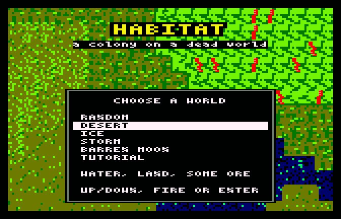
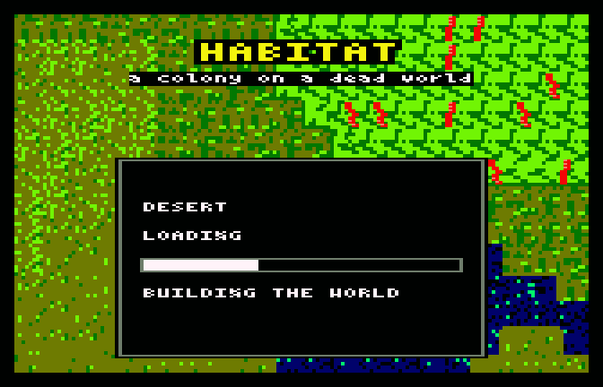
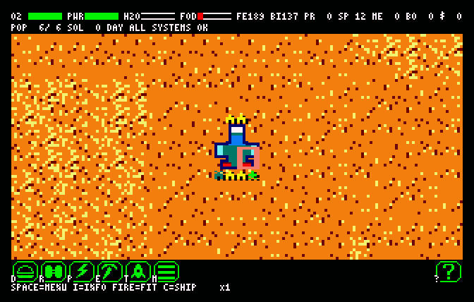
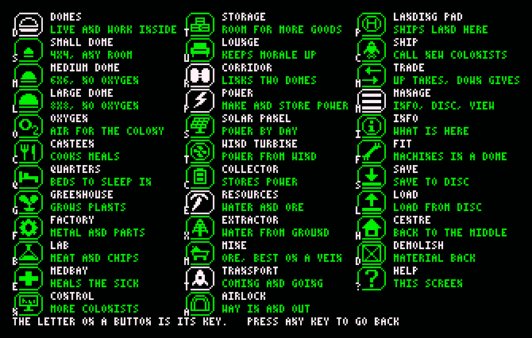
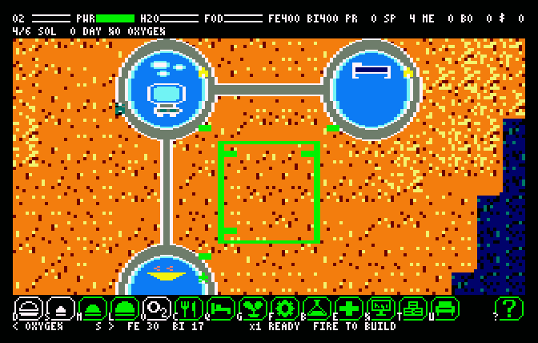
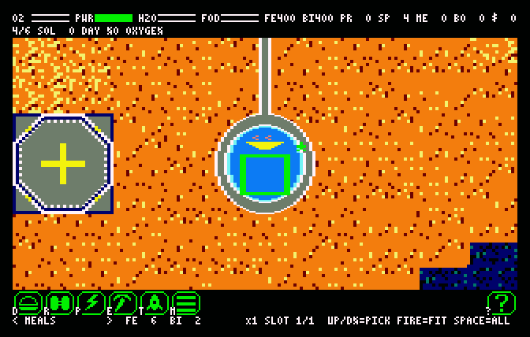
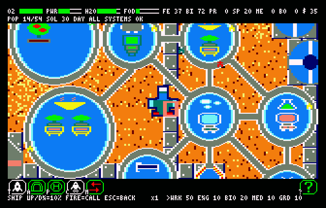

# Habitat — Player's Manual

*A colony on a dead world, for the Amstrad CPC 6128.*

[Ελληνικά](manual-el.md) · [README](../README.md)


---

## Contents

1. [What Habitat is](#1-what-habitat-is)
2. [What you need](#2-what-you-need)
3. [Starting a game](#3-starting-a-game)
4. [The screen](#4-the-screen)
5. [Controls](#5-controls)
6. [Your first colony, step by step](#6-your-first-colony-step-by-step)
7. [Building](#7-building)
8. [Domes, rooms and machines](#8-domes-rooms-and-machines)
9. [Outside the domes](#9-outside-the-domes)
10. [Colonists and bots](#10-colonists-and-bots)
11. [Power, air, water, food, storage](#11-power-air-water-food-storage)
12. [Ships: colonists, visitors, merchants, intruders](#12-ships-colonists-visitors-merchants-intruders)
13. [Hazards](#13-hazards)
14. [The alert line](#14-the-alert-line)
15. [Info, demolition, speed, saving](#15-info-demolition-speed-saving)
16. [Goals, and losing](#16-goals-and-losing)
17. [Tips](#17-tips)
18. [Limits worth knowing](#18-limits-worth-knowing)

---

## 1. What Habitat is

A ship drops six colonists and a hold full of materials on an empty world, and you
are the base's architect. You decide **where** things go, never **who** does what.
The colonists walk out, take whatever work your buildings offer, and look after
their own needs. If you place an oxygen generator with no power, nobody stops you:
they suffocate.

The loop is: **place → produce → survive the night → call the next ship → place
more.** Every building needs something another building makes, and the colony is
always one broken link away from trouble. Habitat is modelled on *Planetbase*
(Madruga Works, 2015), cut down to fit a Z80 and 128 KB.

There is no victory screen. A colony either goes on, or it does not.

## 2. What you need

- An **Amstrad CPC 6128** (the game needs all 128 KB) with its disc drive, or a CPC
  emulator set to a 6128.
- The game disc, `habitat.dsk` (see the [README](../README.md) for how it is built).
- **The game saves onto its own disc.** Use a copy, and do not write-protect it,
  or saving will fail with `DISC ERROR`.

## 3. Starting a game

Insert the disc and type:

```
RUN"HABITAT
```

After a few seconds the menu appears over a piece of a world, a different one each
time.



**CHOOSE A WORLD** — move with the cursor keys or the joystick, and choose with
`FIRE` or `ENTER`. The line under the list describes the world:

| Line | World |
|---|---|
| `RANDOM` | any of the four |
| `DESERT` | water, land, some ore |
| `ICE` | most water, some ore |
| `STORM` | mountains, ore, dry |
| `BARREN MOON` | dust, ore, little water |
| `TUTORIAL` | learn to build a colony (always the same barren moon) |

Every choice except `TUTORIAL` builds a **new world** of that kind, generated from a
random seed. The game loads, then builds the world in about five seconds, with a
tune.



The game starts with nothing built: the six colonists stand outside beside the
ship, in the middle of the map.



The ship's hold brings **60 Water, 100 Food, 60 Ore, 189 Metal, 137 Bioplastic and
12 Spares**. The six are four workers, an engineer and a biologist. Their suits hold
about ten minutes of air, so the first domes are urgent.

## 4. The screen

**The top rows** (the HUD):

```
O2 ██████ PWR ██████ H2O ████·· FOD ██····  FE189 BI137 PR  0 SP 12 ME  0 BO  0 $  0
6/6 SOL  0 DAY ALL SYSTEMS OK
```

- **Four bars:** oxygen (`O2`), power (`PWR`), water (`H2O`) and food (`FOD`). A bar
  turns **red below one third**.
- **Six stocks:**
  - `FE` Metal;
  - `BI` Bioplastic;
  - `PR` Processors;
  - `SP` Spares;
  - `ME` Medicine;
  - `BO` Bots waiting to wake.
- **`$` coins**, which visitors pay.
- **Colonists alive / cap** (`6/6`, `140/160`), the **sol** (day number), `DAY` or
  `NGT` (night).
- **The alert line**: the most urgent thing going on ([section 14](#14-the-alert-line)).

**The play area** shows 20 × 10 tiles of the world. The camera follows the cursor
at the edges of the view.

**The bottom rows:**
- **The button bar** has six groups and help: `D` domes, `R` corridor, `P` power,
  `E` resources, `T` transport, `M` manage, `?` help. Inside a group the bar shows
  that group's buttons.
- **The key line** says what the keys do right now, for example
  `SPACE=MENU I=INFO FIRE=FIT C=SHIP`.
- **The speed**: `PAUSE`, `x1`, `x2` or `x4`.
- **While building**, the two rows show the selection and its price, and whether it
  can be placed: `READY  FIRE TO BUILD`, or the reason it cannot.

## 5. Controls

Everything has a key. The four directions and the two fire buttons also work on the
joystick.

| Key | Action |
|---|---|
| Cursor keys / joystick | Move the cursor, one tile a press. Held, it moves again every fifth of a second. In a menu, left/right picks the item and up/down the room. |
| `FIRE` / `COPY` | Select, confirm, place. On a dome, with nothing selected: open its machines (`FIT`). |
| `ESC` / fire 2 | Cancel, back. |
| `SPACE` | Go to the button bar. Left/right picks a group, `FIRE` or `SPACE` opens it. It opens on the last group you built from, so `SPACE` `SPACE` returns to where you were. While you place a building or a corridor, `SPACE` places it, as `FIRE` does. |
| The letter on a button | Press that button while it is on the bar. From the main view: `D` `R` `P` `E` `T` `M`. |
| `?` (the `/` key) | The help screen: every button with one line about it. Any key returns. |
| `1` `2` `3` `4` | Speed: pause, normal, ×2, ×4. You can still build while paused. |
| `I` | Info: what is under the cursor. |
| `H` | Centre the view on the middle of the map, where the ship is. |
| `S` / `L` | Save / load, from the main view ([section 15](#15-info-demolition-speed-saving)). |
| `C` | Call a colonist ship ([section 12](#12-ships-colonists-visitors-merchants-intruders)). |



**The buttons inside each group:**

| Group | Buttons |
|---|---|
| `D` DOMES | `S` small, `M` medium, `L` large; then the room: `O` oxygen, `C` canteen, `Q` quarters, `G` greenhouse, `F` factory, `B` lab, `E` medbay, `N` control, `T` storage, `U` lounge |
| `R` CORRIDOR | link two domes yourself |
| `P` POWER | `S` solar panel, `T` wind turbine, `C` collector |
| `E` RESOURCES | `X` extractor (water), `M` mine (ore) |
| `T` TRANSPORT | `A` airlock, `P` landing pad, `C` ship, `M` trade |
| `M` MANAGE | `I` info, `F` fit, `S` save, `L` load, `H` centre, `D` demolish |

A button drawn in red cannot be used right now. For example, `TRADE` is red while no
merchant is at the pad.

## 6. Your first colony, step by step

This is the order the tutorial teaches, and a good opening on any world. The letters
are the keys to press, starting from the main view.

| # | Keys | Build |
|---|---|---|
| 1 | `P` `S` | a **solar panel**, then `FIRE` to place it |
| 2 | `D` `S` `O` | a small **oxygen dome**; then `FIRE` on the dome, and `FIRE` again to fit its `OXYGEN` machine |
| 3 | `T` `A` | an **airlock** by the dome: the only way in and out |
| 4 | `E` `X` | an **extractor** at the water's edge |
| 5 | `D` `S` `C` | a **canteen**, fitted with `MEALS` |
| 6 | `P` `S` | **another solar panel** |
| 7 | `P` `C` | a **collector**, to store power for the night |
| 8 | `E` `M` | a **mine**, on an ore vein if you can |
| 9 | `D` `S` `F` | a **factory**, fitted with `METAL` |
| 10 | `D` `M` `G` | a medium **greenhouse**, fitted with plants |
| 11 | `D` `S` `B` | a **lab**, fitted with `MEAT` |
| 12 | `D` `S` `N` | a **control room** |
| 13 | `T` `P` | a **landing pad** |
| 14 | `C`, `FIRE` | **call a colonist ship** |

In the tutorial each step's line appears under the buttons and is done as soon as
the building is placed. There are no hazards until the ship has been called. Then
the line says `THE COLONY IS YOURS`, and it is a normal game, which you can save like
any other.

## 7. Building



**How to place something:**
1. Pick it from the button bar (for example `D` `S` `O`).
2. A **ghost** of the building follows the cursor. It is green where the building
   can go, and red where it cannot, with the reason on the panel.
3. `FIRE` or `SPACE` places it, and `ESC` goes back.

**What it costs:**
- The panel shows the price in Metal (`FE`) and Bioplastic (`BI`), and a dome's
  price includes its corridors. It is **paid at placement**.
- Then the colonists **carry the materials** to the site, ten at a time.
- When everything has arrived, an **engineer** (or a constructor bot) builds it. If
  nobody can, the alert line says `NO ENGINEER`.

**The rules of placement.** Every building joins the colony when it is placed, within
**12 tiles**. If it cannot join, its ghost is red and the panel says why.
- **A dome** gets a covered corridor to every dome within reach, up to four, and to
  any airlock that has no corridor yet. The first dome can go anywhere.
- **An airlock** is joined by a corridor to the nearest dome. The airlocks are the
  colony's only doors.
- **Everything outside** — panels, turbines, collectors, extractors, mines, the
  landing pad — is joined by a **path on the ground** to the nearest airlock or
  other structure. The first one needs nothing. Colonists walk those paths in their
  suits.
- The `R` button links two domes yourself. Pick the first dome, then the second
  (`PICK THE FIRST DOME`, `NO ROUTE FROM THERE`).
- **Medium and large domes cannot hold oxygen.** Oxygen machines fit only in small
  domes.
- **The extractor needs water within two tiles** (`NEEDS WATER NEARBY`).
- **A mine off an ore vein digs at half speed.** The panel says `NO VEIN  HALF ORE`,
  but you may still build it.

**Messages you may see:**

| Message | Why |
|---|---|
| `BLOCKED` | the ground there is not buildable, or something stands in the way |
| `NOT ENOUGH MATERIAL` | not enough Metal or Bioplastic |
| `TOO FAR` | nothing it could join is within 12 tiles |
| `PATH BLOCKED` | a corridor or path cannot get through |
| `NO CORRIDOR FITS` | the two domes are almost diagonal to each other; move one a little |
| `NEEDS WATER NEARBY` | the extractor is not at the water |
| `NO VEIN  HALF ORE` | the mine is allowed, at half yield |

## 8. Domes, rooms and machines

A dome has a **size** and a **room**, chosen when you place it. The room cannot be
changed afterwards.

| Size | Footprint | Machine slots |
|---|---|---|
| small (`S`) | 4 × 4 tiles | 1 |
| medium (`M`) | 6 × 6 | 4 |
| large (`L`) | 8 × 8 | 8 |

**A dome is built empty.** To put machines in it, **fit** it:



- `FIRE` on a dome (or `M` `F`) opens it.
- Left/right picks a slot, and up/down picks what goes in. The room's main machine
  comes first.
- `FIRE` installs it, and `SPACE` puts the same machine in every slot, as far as the
  materials go. `ESC` closes.
- The box around the slot is green when you can pay for the machine, red when you
  cannot, and pink when it is already there.
- **Each machine is paid for when you fit it.** Its materials are then carried to the
  dome, and an engineer installs it. Until then it is drawn stopped, with a mark.
  Plants grow at once.
- Taking a machine out gives back **half** its price.
- You can fit a dome while it is still being built.
- Quarters, Storage and Lounge have no machines.

**The rooms** (the names are as they appear on screen):

| Room | Machines | What it is for |
|---|---|---|
| **OXYGEN** (small only) | `OXYGEN` | Air for the colony, from Water and Power. One oxygen dome keeps about ten colonists breathing. |
| **CANTEEN** | `MEALS` | Meals from **Starch + Vegetables + Meat**, all three. Colonists eat and drink here. |
| **QUARTERS** | — | Beds: 2 / 6 / 12 by size. |
| **GREENHOUSE** | `STARCH`, `VEGGIES`, `HERBS`, `TREE`, `MIXED` | Plants. Herbs are for medicine. Trees keep morale up, and visitors pay more for them. `MIXED` plants a bit of everything. |
| **FACTORY** | `METAL`, `PLASTIC`, `SPARES`, `ROBOTS`, `WEAPONS` | Ore → Metal. Starch → Bioplastic. Metal + Bioplastic → Spares. Metal + Processors + Bioplastic → a Bot. Metal + Processors → Guns. |
| **LAB** | `MEAT`, `CHIPS`, `DRUGS` | Water + Power → Meat. Metal → Processors. Herbs → Medicine. |
| **MEDBAY** | `BEDS`, `CABINET` | Heals the sick, using Medicine. |
| **CONTROL** | `CHIPS` | Raises the colony's size by 48, and lets you call ships. |
| **STORAGE** | — | Room for 100 / 300 / 600 more goods by size. |
| **LOUNGE** | — | Keeps morale up, and visitors pay more. |

**Most machines need someone to work them.** Workers run the machines, and
biologists tend the plants. The more people stand in a dome, the more of its
machines turn. The `OXYGEN` machine runs on its own.

**The colony keeps some reserves by itself:**
- the machines that use Metal (`SPARES`, `ROBOTS`, `WEAPONS`, `CHIPS`) stop while
  Metal is under 30;
- `PLASTIC` stops while Bioplastic is at 100 or more;
- `SPARES` stops at 20 Spares.

Building, fitting and trading are never limited by these.

## 9. Outside the domes

| Structure | What it does |
|---|---|
| **SOLAR PANEL** | Power by day. Nothing at night or in a sandstorm. |
| **WIND TURBINE** | Power from the wind, day and night. |
| **COLLECTOR** | Stores the day's spare power for the night. |
| **EXTRACTOR** | Water from the ground, beside water. |
| **MINE** | Ore. 1–3 people dig: more diggers, more ore. **Your colony's first mine is free.** The ore piles up at the mine (up to 30, then it stops) and is carried to storage or to the ship, ten at a time. |
| **AIRLOCK** | The way in and out. |
| **LANDING PAD** | Ships land here. You need one for every kind of ship. |

**Outside, colonists breathe from their suits.**
- A suit holds about ten minutes of air at the start. After that it holds about three
  minutes a trip, refilled free every time they go out.
- With under a minute left the alert line says `SUIT AIR LOW` and they head back.
- **When a suit is empty, the colonist dies.**

Keep airlocks close to the structures people work at.

## 10. Colonists and bots

**Five specialties**, shown on the ship's line as:
- `WRK` worker: runs machines, digs, carries;
- `ENG` engineer: builds, installs machines, repairs;
- `BIO` biologist: tends greenhouses;
- `MED` medic: heals;
- `GRD` guard: fights intruders.

Anyone can carry materials. Nobody takes orders: they take the work the buildings
post, the most urgent first, from the nearest.

**Six needs:**
- **Oxygen.** Inside, from the colony's air. Outside, from the suit.
- **Water and food**, at a canteen.
- **Sleep**, in quarters.
- **Health**, healed in a medbay with Medicine.
- **Morale.** Lounges, trees and visitors raise it, and deaths lower everyone's.

When a need runs low, a colonist drops their work and goes to see to it. If the
canteen is on the far side of the base, you will watch production stop for the walk.

**Bots** are made by the `ROBOTS` machine. Each one goes into the Bots stock (`BO`)
and wakes at a factory with a `ROBOTS` machine, up to sixteen. A bot becomes a
constructor, a carrier or a driller, as the colony needs. Bots do not breathe, eat
or sleep. You can also buy them from a merchant.

The colony holds up to **160 colonists** and **16 bots**. Its size starts at 6 and
grows by 48 with each Control room: 54 with one, 102 with two, 150 with three, and
the full 160 with four.

## 11. Power, air, water, food, storage

- **A sol** (a day) lasts four minutes at normal speed, and about 40% of it is night.
- **Power.** Panels give nothing at night. A collector carries the colony through it,
  and turbines turn in the dark.
  - When power runs short the colony sheds load: only life support keeps running, and
    the line says `LOW POWER`.
  - With no power at all it says `NO POWER`: the machines stop, then the oxygen.
- **Air.** Without enough oxygen machines, or without power or water for them, the
  line says `NO OXYGEN` and health drains fast.
- **Food.** A canteen's `MEALS` machine feeds about six colonists, and it needs
  Starch, Vegetables and Meat together. The greenhouse makes the first two and the
  lab the third.
- **Storage.**
  - Until you build a Storage dome, the ship's hold is your store: 500 for everything
    but Water.
  - Each Storage dome adds 100, 300 or 600 by size.
  - When the store is full the line says `STORAGE FULL`. The greenhouses, the mines
    and the meat printer stop, except for whichever of Starch, Vegetables and Meat is
    scarcest.

## 12. Ships: colonists, visitors, merchants, intruders

All ships land on the **landing pad**, one at a time.

**Colonist ships come when you call them.**
- They need a **Control room** and a **landing pad**.
- `C` (or the `SHIP` button) opens the ship's line:

  

- Left/right picks a specialty, and up/down moves its share in steps of 10%. The
  shares always add up to 100.
- `FIRE` calls the ship. It comes down a few seconds later with **four colonists**,
  each of the specialty your colony lacks most against the shares.
- The messages: `NEED A CONTROL ROOM`, `NEED A LANDING PAD`, `A SHIP IS ALREADY
  DUE`, `COLONIST SHIP CALLED`.

**Visitors come on their own**, and more often as the colony's **prestige** grows.
- Two to five land and walk to a canteen to eat and drink, paying **5 coins** each,
  and 3 more if you have a lounge or trees. Then they visit a lounge, if there is
  one, and walk back to their ship.
- With no canteen, food or water they leave hungry, and the colony's goodwill falls.
- **Prestige** grows with the colony's milestones, with the colonists alive, with sols
  without a death, with lounges and trees, and with goodwill.

**A merchant lands about every 2.7 sols** and stays half a sol. The line
says `MERCHANT LANDED`, and `T` `M` (the `TRADE` button) opens the trade line:

```
+40% TAKE  210 GIVE  250 FIRE=DEAL
 <METAL  > SHIP 20 TAKE 10 HAVE  75 @ 15
```

- Left/right walks through the goods, the merchant's own first.
- **Up** takes one more lot, and **down** gives one more.
- The top line weighs what you take, at the merchant's prices, against what you give,
  at their value. `FIRE` makes the deal when you give at least as much as you take.
- **One deal per visit.** Colonists and carrier bots carry the goods to and from the
  pad, and the merchant leaves when they are done.
- Coins can be traded too.

**Intruders.** Once the colony has 20 colonists, about one landing in eight brings
two to four intruders.
- They look like colonists in red. The line says `INTRUDERS`.
- Everyone outside heads in through the nearest airlock, and the guards fight.
- At the alert each guard takes a Gun from the store, if there is one, and keeps it.
  With a Gun a guard hits twice as hard, and can also shoot into the next dome or
  structure.

## 13. Hazards

| Hazard | What it does | What helps |
|---|---|---|
| **Night** | no solar power | collectors, turbines |
| **Malfunction** | a machine stops dead (`BROKEN` and its name) | an engineer and **one Spare** per repair |
| **Sandstorm** | no solar power, and anyone outside is hurt | turbines, collectors, staying inside |
| **Solar flare** | three machines stop at once | Spares, engineers |
| **Meteor shower** | eight impacts round one building: structures are knocked back to sites, machines stop, craters appear | spread-out building, Spares, builders |
| **Intruders** | they strike whoever stands in front of them | guards, Guns |

Malfunctions come from the first sol. Sandstorms, flares and meteor showers start once
the colony has 20 colonists, and come at least two sols apart. A broken machine shows a
red mark until it is repaired. One still waiting to be installed shows a different
mark.

## 14. The alert line

The line shows the most urgent message, in this order:

| Message | Meaning |
|---|---|
| `NO POWER` | No power at all: machines stop, then oxygen. |
| `NO OXYGEN` | Life support is short. Health drains fast. |
| `INTRUDERS` | Someone is being attacked. |
| `SUIT AIR LOW` | Someone outside has less than a minute of air. |
| `LOW POWER` | Load shed: only life support is running. |
| `METEOR SHOWER` | Impacts are falling now. |
| `LOW ON FOOD` / `LOW ON WATER` | Less than one portion per colonist left. |
| `NO ENGINEER` … | Something waits to be built or installed, and nobody alive can do it. The line names what waits. |
| `BROKEN` … | A machine waits for its repair. The line names the machine. |
| `SANDSTORM` | A sandstorm is blowing. |
| `STORAGE FULL` | Production that adds to the store has stopped. |
| `MERCHANT LANDED` | A merchant is at the pad. |
| `COLONY LOST` | Everyone is dead. |
| `ALL SYSTEMS OK` | Nothing to report. |

## 15. Info, demolition, speed, saving

- **Info** (`I`, or `M` `I`): what is under the cursor — the building, its state
  (`SITE` or `ACTIVE`), its condition (`HP`), and the ground (`GROUND`, `DUST`,
  `ROCK`, `MOUNTAIN`, `WATER`, `ORE VEIN`…).
- **Demolish**: put the cursor on the building, then `M` `D` and `FIRE`.
  - It works on domes and structures, finished or not, but never on the ship. A
    dome's corridors go with it.
  - While a ship is due or at the pad, the pad and the Storage domes cannot be
    demolished.
  - You get back **half** of what the building, its corridors and its machines cost.
    A site that was never finished gives everything back.
  - Whoever is inside walks out.
- **Speed**: `1` pause, `2` normal, `3` ×2, `4` ×4. At ×4 the screen may skip frames,
  because the simulation does four times the work. Paused, you can still look around
  and build.
- **Saving and loading** (`S` / `L` from the main view, or `M` `S` / `M` `L`):
  - Left/right picks one of **three slots**, `FIRE` goes, and `ESC` backs out.
  - The messages: `SAVING TO DISC...`, `SAVED TO SLOT 1`, `LOADING FROM DISC...`,
    `LOADED FROM SLOT 1`, `NOTHING IN SLOT 2` (an empty slot), `DISC ERROR`.
  - Saves are written to the game disc.

## 16. Goals, and losing

There is no victory screen. The game counts five **milestones** once a sol, and
they raise the colony's prestige, which brings visitors:

| Milestone | What it takes |
|---|---|
| Foothold | 10 colonists, all needs green for one sol |
| Industry | Metal, Bioplastic and Spares made in the colony |
| Independence | all ten goods made in the colony, and no trade for five sols |
| Automation | 8 bots |
| Habitat | 80 colonists, independent, five sols in a row with no deaths |

**The colony is lost only when everyone is dead** (`COLONY LOST`). A colony of two
with no power is still alive, and saving it is the point.

## 17. Tips

- **Power first, then air.** The tutorial's second solar panel and its collector
  before the first night are there for a reason.
- **One oxygen dome for about every ten colonists.** Keep it powered and supplied with
  water.
- **Meals need all three foods.** A greenhouse alone, or a lab alone, will not feed
  anyone.
- **Keep Spares in store.** Every repair takes one, and a broken `OXYGEN` machine with
  no Spares can kill a large colony. Build a `SPARES` machine early: it stops by
  itself at 20.
- **Keep the canteen close to where people work.** Hungry colonists drop their work
  to walk to it.
- **Build airlocks near the structures outside.** Every trip is spent in a suit.
- **Add Storage before the store fills.** A full store stops the greenhouses and the
  mines.
- **Call ships when there is room, food and air for them.** Four colonists arrive at
  once.
- **Spread out the domes** once the colony passes twenty: meteor showers strike round
  one building.

## 18. Limits worth knowing

- Only **eight domes of each room** count for the colony's searches. A ninth canteen
  or quarters is never chosen for a need, and a ninth Storage adds no room. Its
  machines still run.
- A new dome gets corridors to **at most four** domes.
- Two domes almost diagonal to each other cannot be joined (`NO CORRIDOR FITS`). Move
  one by a tile or two.
- Colonists walking outside are drawn on top of whatever they pass.
- The colony holds 160 colonists and 16 bots.
